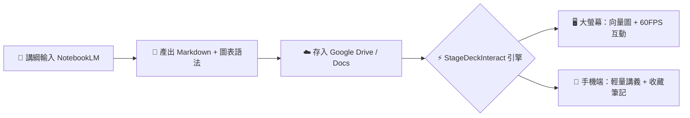

mode: SLIDE
layout: COVER
title: NotebookLM × 快速生圖展示
subtitle: 一份 Markdown / Google Docs 即可自動繪製流程圖、數據圖表與互動卡片
body: 掃描右側 QR Code 同步查看手機講義與即時投票
> speaker_note: 這個範本展示系統如何直接吃進 NotebookLM 產出的 Markdown，自動繪製 Mermaid 流程圖、動態數據圖與資訊圖卡。

---

mode: SLIDE
layout: CARDS
title: 三步驟打通 NotebookLM 自動化簡報流
subtitle: 免截圖、免手調排版，文字直接變視覺
flow: true
- STEP 1 · 匯入講綱 | 在 NotebookLM 貼上講綱與專用 Prompt，一鍵輸出 Markdown 腳本
- STEP 2 · 丟進雲端 | 匯出至 Google Docs 或存成 .md 放入 Google Drive 開啟檢視權限
- STEP 3 · 即時渲染 | 將連結貼入 /admin，大螢幕自動長出向量圖表與六大互動特效
> speaker_note: 只要三步：NotebookLM 出稿、放進 Google Drive、貼連結進本系統，立即開講！

---

mode: SLIDE
layout: DIAGRAM
title: 系統自動繪圖架構（Mermaid 即時渲染）
subtitle: 自動套用主題配色，支援流程圖、心智圖與時序圖

> speaker_note: 這張流程圖沒有任何圖片檔，完全是由 Markdown 裡的 Mermaid 語法在瀏覽器即時渲染出來的。

---

mode: SLIDE
layout: CHART
title: 各階段備課耗時比較（分鐘）
subtitle: 純文字數據語法自動繪製動態長條圖
type: bar
unit: 分鐘
傳統手動做 PPT 與問卷: 180
對話式 AI 複製貼上排版: 75
NotebookLM + 本系統工作流: 15
> speaker_note: 透過內建圖表引擎，講綱裡只要寫出「項目: 數值」，系統就會自動畫出帶動畫的數據比較圖。

---

mode: BUBBLE
title: 你最常用到哪一種視覺圖表？
subtitle: 單選投票，測試即時互動與圖表切換
opt_1: 流程與系統架構圖 (Mermaid)
opt_2: 數據比較長條／圓餅圖 (Chart)
opt_3: 步驟與對比資訊圖卡 (Cards)
opt_4: 雷達圖與多維評估 (Radar)
> speaker_note: 投完票後我們接著看看下一頁的雷達圖範例！

---

mode: SLIDE
layout: CHART
title: 新工作流綜合能力評估
subtitle: 支援 radar 雷達圖、pie 圓餅圖與 line 折線圖
type: radar
unit: 分
備課省時度: 95
視覺豐富度: 90
現場互動感: 96
手機輕量化: 98
跨場次複用性: 95
> speaker_note: 除了長條圖，改一行 type: radar 就能立刻切換為多維雷達圖。
